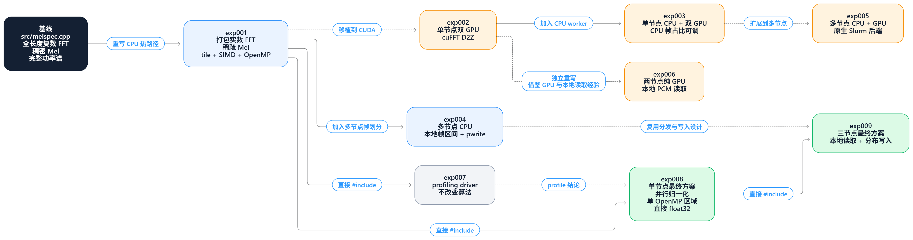

# Melspec 性能优化完整报告

> 项目：七边形 2026 年秋季招新高性能计算题
>
> 日期：2026-10-31
>
> 结论：单节点最终方案 exp008 为 `2.733 s`，三节点最终方案 exp009 为
> `2.186 s`，两者均通过官方四个用例。

本文档合并了优化过程笔记、分实验报告和最终总结。它面向第一次接触本项目的
读者，重点说明每一步为什么做、具体怎么实现、产生了什么效果，以及背后的 HPC
知识点。

## 阅读建议

- 想快速看结果：阅读“最终结果”和“跨实验结论”。
- 想看完整优化过程：从“原始实现为什么慢”顺序阅读。
- 想准备答辩：结合 [presentation-script.md](presentation-script.md) 使用。
- 想先补 Mel 算法基础：阅读
  [reference/melspec-basics.md](reference/melspec-basics.md)。

## 目录

1. [最终结果](#1-最终结果)
2. [题目与评测口径](#2-题目与评测口径)
3. [原始实现为什么慢](#3-原始实现为什么慢)
4. [实验设计方法](#4-实验设计方法)
5. [代码演进关系](#5-代码演进关系)
6. [exp001：把算法浪费先消掉](#6-实验-001把算法浪费先消掉)
7. [GPU 与多节点探索](#7-实验-002006gpu-与多节点探索)
8. [exp007–009：单节点与多节点最终方案](#8-实验-007从热点转向数据路径)
9. [跨实验结论](#11-跨实验结论)
10. [正确性、复现、参考与经验](#12-正确性和复现)

## 1. 最终结果

### 1.1 两个最终方案

| 方案 | 配置 | 四用例合计 | 相对 exp001 | 正确性 |
|---|---|---:|---:|---|
| exp008 单节点最终 | 1 节点，64 CPU 线程 | `2.733 s` | `1.382x` | `4/4 PASS` |
| exp009 三节点最终 | 3 节点，每节点 64 CPU 线程 | `2.186 s` | `1.728x` | `4/4 PASS` |

exp009 是总体最快实现。它与 exp001 使用同一套 FFT 和 Mel 数学，主要收益来自
更短的数据路径、本地 PCM 区间读取、三节点帧级并行和不重叠的分布式输出。

### 1.2 九个实验总表

| 实验 | 部署配置 | 核心思路 | 四用例合计 | 相对 exp001 |
|---|---|---|---:|---:|
| 001 | 单节点，64 CPU 线程 | 打包实数 FFT、稀疏 Mel、分块、SIMD、OpenMP | 3.777 s | 1.000x |
| 002 | 单节点，2×L40 | cuFFT D2Z 与 GPU Mel | 5.164 s | 0.731x |
| 003 | 单节点，CPU+2×L40 | CPU 与 GPU 同时处理不同帧 | 5.207 s | 0.725x |
| 004 | 3 节点 CPU | 本地帧区间、原生 Slurm、分布写入 | 2.533 s | 1.491x |
| 005 | 2 节点 CPU+GPU | 多节点异构 | 5.179 s | 0.729x |
| 006 | 2 节点纯 GPU，共 4×L40 | CPU 不参与逐帧计算 | 4.024 s | 0.939x |
| 007 | 单节点 profile | 分阶段测量 exp001 | 仅分析 | 基线分析 |
| 008 | 单节点 CPU | 并行归一化、单并行区、直接 float32 | 2.733 s | 1.382x |
| 009 | 3 节点 CPU | exp008 数据路径 + 三节点流水 | **2.186 s** | **1.728x** |

### 1.3 官方四用例明细

单位均为秒，来源为对应 Slurm 作业的三次运行最小值。

| 实验 | default | small_mels | large_fft | narrow_band | 合计 |
|---|---:|---:|---:|---:|---:|
| 001 | 0.931 | 0.569 | 1.155 | 1.122 | 3.777 |
| 002 | 1.341 | 0.925 | 1.444 | 1.454 | 5.164 |
| 003 | 1.353 | 0.929 | 1.474 | 1.451 | 5.207 |
| 004 | 0.693 | 0.305 | 0.773 | 0.762 | 2.533 |
| 005 | 1.376 | 0.904 | 1.454 | 1.445 | 5.179 |
| 006 | 1.068 | 0.729 | 1.113 | 1.114 | 4.024 |
| 008 | 0.629 | 0.470 | 0.827 | 0.807 | 2.733 |
| 009 | **0.599** | **0.275** | **0.661** | **0.651** | **2.186** |

### 1.4 相对原始实现的短前缀对照

完整原始实现运行成本很高，因此同一 1M 样本 default 前缀只用于速度对照，
不替代官方四用例正确性验证。

| 方案 | 原实现 | 优化实现 | 加速 |
|---|---:|---:|---:|
| exp001 | 61.663 s | 0.084 s | 731.206x |
| exp008 | 62.461 s | 0.044 s | 1427.391x |
| exp009 | 62.336 s | 0.399 s | 156.271x |

## 2. 题目与评测口径

程序从 int16 小端 PCM 计算 Mel 谱图，输出 float32 行优先矩阵
`[n_mels, n_frames]`。计算语义保持为：

1. PCM 转 double 并除以 32768；
2. 按 `hop_length` 取长度为 `n_fft` 的帧，不做 center padding；
3. 乘周期性 Hann 窗；
4. 做非归一化实数 FFT；
5. 计算复数频点的平方幅度；
6. 使用 HTK Mel 刻度和 Slaney 面积归一化；
7. 把三角滤波器组应用到功率谱。

不得改变 `src/main.cpp`、`include/melspec.h`、`melspec.py`、`validate.py`、
CLI 参数、输入数据和输出格式。

正式验收使用四个官方参数族，要求 `4/4 PASS`。数值门限为
`rtol=1e-3`、`atol=1e-4`。每个用例运行三次并取最小值。聚合加速比统一定义为：

```text
Speedup = T_exp001 / T_experiment
```

所有正式计算通过 Slurm 在 `hepnode1~3` 上执行。`hepnode0` 只用于登录和作业
管理。

### 2.1 评测环境

| 项目 | 配置 |
|---|---|
| CPU | Intel Xeon Gold 6338，每节点 64 核 |
| GPU | 每节点 2 × NVIDIA L40 |
| 操作系统 | Ubuntu 26.04 LTS |
| 编译器 | GCC/G++ 15.2.0 |
| 调度器 | Slurm 25.11.2 |
| Python 验证环境 | NumPy 2.5.4、SciPy 1.18.1、librosa 1.0.0 |

## 3. 原始实现为什么慢

原始实现是正确的，但它把大量与帧内容无关的工作重复了近 20 万次。默认用例
约包含 192,397 帧，因此固定常数成本会被帧数放大。

### 3.1 每帧重复构造 FFT 准备信息

原实现每帧重新分配帧数组、复数数组和输出数组，重复做位反转，并在每一级
蝶形中重新计算 twiddle 的 `cos` 和 `sin`。

位反转索引和 twiddle 只由 `n_fft` 决定，与 PCM 内容无关。它们本应在启动时
计算一次，并被所有帧复用。

### 3.2 实数输入仍执行全长度复数 FFT

帧的虚部全部为零，但原实现仍构造 `n_fft` 点复数数组并执行完整复数 FFT。
实序列频谱满足共轭对称性：

```text
X[N-k] = conj(X[k])
```

因此负频率一半是冗余的。通过把相邻实样本打包到复数的实部和虚部，可以让
核心复数 FFT 的长度从 `n_fft` 降到 `n_fft/2`。

### 3.3 稠密 Mel 投影包含大量乘零

原实现为每个 Mel 带扫描全部 `n_fft/2+1` 个频点。复杂度约为：

```text
O(n_mels × n_bins × n_frames)
```

三角滤波器只在局部频段非零。大部分乘法权重为零，却仍消耗指令、寄存器带宽
和内存读取机会。

### 3.4 完整 double 功率谱过大且缓存局部性差

default 用例的功率谱形状为 `[4097, 192397]`。若保存 double，需要约 `6.3 GB`。
16K FFT 用例约需 `12.6 GB`。

原布局为 `power[k][t]`。投影固定一帧 `t` 并增加频点 `k` 时，访问会跨过整行，
缓存行利用率很低。即使机器内存足够，完整矩阵也远超 L3，无法留在缓存中。

### 3.5 基线 profiling 给出的优化顺序

早期 profile 显示，在已经消除明显重复工作后，半长度 FFT 约占 `60.1%`，稀疏
Mel 点积和相邻代码约占 `39.4%`，I/O 和其余路径约 `0.5%`。

这决定了优化顺序：

1. 先消除重复准备和不必要的数学工作；
2. 再改变数据布局，避免 GB 级中间矩阵；
3. 接着做 SIMD；
4. 最后做线程级和节点级并行。

先调线程并不能修复“乘以大量零”或“物化 GB 级数组”的结构性问题。

## 4. 实验设计方法

每轮实验遵守以下规则：

1. 不改原始基准 `src/melspec.cpp`；
2. 每个实验保存为独立源码，历史结果不覆盖；
3. 先做小样本正确性检查，再提交官方四用例；
4. 性能统一使用三次最小值；
5. 失败的 Slurm 日志保留，用于解释错误和决策；
6. 本地探索数据只用于开发，不作为最终成绩。

公共构建入口为 [Makefile](../Makefile)：

```bash
make                       # 默认构建 exp008
make final-three-node      # 构建 exp009
make EXPERIMENT=exp001_packed_fft_sparse_mel_simd
```

实验源码位于 `experiments/`，Slurm 脚本按用途位于
`scripts/experiments/`、`scripts/final/` 和 `scripts/diagnostics/`。

## 5. 代码演进关系



- baseline 是原始 `src/melspec.cpp`。
- exp001 是所有 CPU 优化的数学基础。
- exp002、exp003、exp005 和 exp006 探索单节点及多节点 GPU 路线。
- exp004 探索多节点 CPU。
- exp007 测量 exp001 的阶段成本。
- exp008 直接复用 exp001 的数学，重做单节点数据路径。
- exp009 复用 exp008 的实现，并叠加 exp004 的本地帧划分和分布写入。

## 6. 实验 001：把算法浪费先消掉

### 6.1 怎么想到

原始实现最明显的特征不是“线程不够”，而是每一帧都在重复相同工作，并且
大量计算的结果必然为零。因此先利用算法结构和数据类型，再考虑指令级和线程级
并行。

### 6.2 实现过程

#### FFT plan 预计算

启动时构造并复用：

- 位反转表；
- 每一级 twiddle；
- 每一级 twiddle 的偏移；
- 每个线程独立的 FFT 工作区。

PCM 读取、Hann 加窗和位反转写入合并为一次遍历。

#### 打包半长度实数 FFT

把偶数样本和奇数样本分别放入复数序列的实部和虚部：

```text
z[n] = x[2n] / 2 + i x[2n+1] / 2
```

长度从 `n_fft` 降为 `n_fft/2`。完成复数 FFT 后，用共轭对称关系恢复非负频率。
这一步把 8192 点核心复数 FFT 变成 4096 点。

#### 稀疏 Mel 滤波器

对每个滤波器只保存：

- 起始 FFT 箱；
- 非零权重个数；
- 在扁平权重数组中的位置。

投影只遍历三角支撑区间，公式、边界和 Slaney 归一化保持不变。

#### 256 帧分块融合

每个 tile 依次完成 FFT、功率和稀疏 Mel 投影，结果先写入较小的 Mel tile，再按
Mel 行连续复制到最终输出。完整功率谱的生存期缩短到单帧线程私有工作区。

保留 Mel tile 的原因是最终输出为 `[m, t]`。如果每个线程直接逐行写一帧，
相邻线程可能同时修改同一缓存行，引发 false sharing。按连续帧分块，再按行
连续复制，能减少缓存行争用。

#### SIMD、FMA 和 OpenMP

- 实部和虚部分别使用连续数组，减少交错布局的搬运；
- `__restrict` 帮助编译器确认数组不重叠；
- OpenMP `simd` 明确向量化蝶形和 Mel 点积；
- `-march=native` 启用本机 AVX2/AVX-512 与 FMA；
- 每个线程处理连续帧段，并复用固定工作区；
- 一个 tile 只创建一个 parallel region，减少 fork/join 次数。

### 6.3 效果

| 指标 | 结果 |
|---|---:|
| 64 线程官方四用例 | `3.777 s` |
| 单线程同口径 | `79.120 s` |
| 64 线程相对单线程 | 约 `20.95x` |
| 1M default 相对原实现 | `731.206x` |
| 官方正确性 | `4/4 PASS` |

64 线程扩展性明显低于 64x，原因是输入、输出、线程启动、barrier 和内存带宽
仍有串行或共享部分。Amdahl 定律表明，只要这些成本存在，总 wall time 不会
随线程数线性下降。

### 6.4 对应 HPC 知识点

- 算法复杂度与常数因子同样重要；
- 结构复用：把不随数据变化的内容移出热循环；
- 实信号共轭对称性；
- 稀疏计算；
- 数据布局与缓存局部性；
- SIMD、FMA 和自动向量化；
- false sharing；
- OpenMP fork/join 与 barrier；
- Amdahl 定律和强扩展性。

## 7. 实验 002–006：GPU 与多节点探索

### 7.1 exp002：单节点双 GPU

两个 L40 各自处理连续帧区间，使用 `cufftPlanMany`、`CUFFT_D2Z`、GPU 功率谱
和稀疏 Mel kernel。CPU 负责输入读取、GPU 编排和最终写入。

结果为 `5.164 s`。GPU 计算本身很快，但完整 CLI 还要承担 CUDA 初始化、plan
构造、H2D、D2H、stream 同步和文件输出。

HPC 知识点：异构计算中要看端到端时间，不能只看 kernel 时间。

### 7.2 exp003：单节点 CPU+双 GPU

把帧再拆分给 CPU OpenMP 和两个 GPU，尝试让三类计算单元同时工作。调参后
最佳配置为 64 CPU 线程加 4% CPU 帧，总耗时 `5.207 s`。

同步调参中，纯 GPU 约 `5.102 s`，加入 2% CPU 帧后为 `5.179 s`。CPU 和 GPU
共享主机内存、缓存和 I/O，较慢一侧的尾部决定 wall time。

HPC 知识点：异构负载均衡不仅要分配工作量，还要控制资源竞争和尾部延迟。

### 7.3 exp004：多节点 CPU

最早的功能路径使用 MPI，但 `MPI_Init` 和启动成本让短用例增加约 1–2 秒。
性能版改为原生 Slurm 多进程：

- rank 只读取自己的连续 PCM 帧区间；
- 每个 rank 在本节点使用 OpenMP；
- 用 64-bit token 协调输出 ready 状态；
- 各 rank 直接 `pwrite` 不重叠帧列，不做 Gather。

三节点结果为 `2.533 s`。两节点旧路径为 `3.083 s`，说明增加节点并不会自动
变快，数据路径和启动成本必须同步优化。

HPC 知识点：SPMD、进程与线程混合并行、通信 vs I/O、文件的并发不重叠写入、
启动延迟和弱扩展性。

### 7.4 exp005：多节点 CPU+GPU 异构

每个节点使用一个 rank、两个 GPU 和 OpenMP CPU。节点间使用原生 Slurm 协调和
float32 分布写入。两节点结果为 `5.179 s`。

增加节点后仍与单节点 GPU 基本持平，因为每个 rank 仍读取完整 PCM，GPU 路径
也保留了传输、同步和输出瓶颈。

HPC 知识点：分布式异构系统中，局部加速必须抵消全局 I/O 和协调成本。

### 7.5 exp006：两节点纯 GPU

每个节点运行一个 rank，CPU 完全不参与逐帧 FFT、功率或 Mel 计算。Hann 窗、
cuFFT、功率谱、稀疏 Mel 和 float32 转换都在 GPU 上完成。

结果为 `4.024 s`，是 GPU 路线最快方案，但仍慢于 exp001 的 `3.777 s`。

exp006 default profile：

| 阶段 | rank 0 | rank 1 |
|---|---:|---:|
| 本地 PCM 读取 | 0.093 s | 0.093 s |
| CUDA 初始化和 plan | 0.060 s | 0.056 s |
| H2D、kernel、D2H、同步 | 0.161 s | 0.233 s |
| 共享输出写入 | 0.280 s | 0.489 s |

每处理最多 1024 帧同步一次，default 中每 rank 约同步 94 次。D2H 使用 pageable
缓冲，下一批计算无法与上一批传输重叠。default 完整输出约 188 MiB。

结论：输入磁盘读取不是主因，主要损失在设备传输、同步和共享输出 I/O。

HPC 知识点：异步传输、pinned memory、双缓冲、stream 同步、Arithmetic
Intensity、Roofline 思想和 kernel 之外的固定开销。

## 8. 实验 007：从热点转向数据路径

exp007 包装未修改的 exp001 kernel，把 default 拆成四个阶段：

| 阶段 | 耗时 |
|---|---:|
| PCM 读取与归一化 | 约 0.20 s |
| FFT、功率和 Mel 计算 | 约 0.49–0.51 s |
| double 到 float32 与写入 | 约 0.23–0.25 s |
| 总计 | 约 0.93–0.96 s |

完整写盘和 `/dev/null` 输出只差约 70–90 ms，说明主要成本不是磁盘 payload，
而是串行归一化、完整 double 输出矩阵和最后一遍转换。

exp001 default 峰值 RSS 约 779 MB。

这一结果直接启发了 exp008：继续优化 FFT 的收益有限，应先缩短数据路径。

## 9. 实验 008：单节点最终方案

### 9.1 怎么想到

exp007 表明数据准备、double 输出和转换仍占显著时间。exp008 因此保留
exp001 的 FFT 和 Mel 数学，只处理数据生命周期和并行粒度。

### 9.2 实现过程

1. PCM 归一化从串行改为 64 线程 OpenMP；
2. 不再为每个 256 帧 tile 创建独立 parallel region，改为一个区域覆盖全部
   帧；
3. 线程完成 Mel 后直接写 float32；
4. 删除完整 double Mel 输出矩阵；
5. 删除 double tile staging matrix；
6. 删除最后一遍串行 double 到 float32 转换。

### 9.3 效果

default profile：

```text
读取 0.06 s + 归一化 0.11 s + 计算 0.36 s + 写入 0.08 s
```

峰值 RSS 从约 779 MB 降至 394 MB。四用例合计从 `3.777 s` 降至 `2.733 s`，
相对 exp001 为 `1.382x`；1M default 相对原实现为 `1427.391x`。

### 9.4 对应 HPC 知识点

- 数据流优化和内存生命周期；
- 避免不必要的 double 中间表示；
- 减少 parallel region、barrier 和线程唤醒次数；
- 并行 I/O 前的数据准备同样可能成为热点；
- 峰值内存与缓存工作集会影响可扩展性。

## 10. 实验 009：三节点最终方案

### 10.1 怎么想到

exp008 后，单节点计算已明显缩短，剩余成本集中在帧规模和完整输出。自然做法
是按连续帧区间把工作拆到多个节点。

### 10.2 实现过程

- 每个 rank 只读取自己需要的连续 PCM 区间；
- 读取后并行归一化；
- 使用 exp008 的单 OpenMP 区域直接计算 float32；
- rank 0 准备共享输出并写入每轮 64-bit token；
- 其他 rank 用 `pread` 确认 token；
- 所有 rank 向不重叠帧列 `pwrite`；
- 不需要 Gather，也不需要把所有数据交给 rank 0。

### 10.3 效果

exp009 default profile 中，每 rank 读取约 `0.02 s`、并行归一化约 `0.04 s`、
计算约 `0.13 s`、分布式写入约 `0.28 s`。

四用例合计 `2.186 s`，相对 exp001 为 `1.728x`，相对 exp004 为 `1.159x`。
三个节点上四个单用例均通过。

### 10.4 对应 HPC 知识点

- SPMD 和局部数据划分；
- 进程级与线程级并行叠加；
- 通信规避：用不重叠文件写入替代 Gather；
- 共享文件系统上的并发 I/O；
- token 协调和确定性初始化；
- 启动成本、尾部延迟和弱扩展性。

## 11. 跨实验结论

### 11.1 为什么整道题最终是纯 CPU 更快

这不是“CPU 算术普遍快于 GPU”的结论。当前工作负载和完整 CLI 有以下特点：

- 四个用例进程较短；
- 每批 1024 帧就同步一次；
- D2H 使用 pageable 缓冲；
- GPU 路径没有把传输、计算和写盘充分流水化；
- 完整 default 输出约 188 MiB；
- 输出写入共享文件系统；
- CPU 路径已经利用实数 FFT、稀疏 Mel、SIMD 和 64 核 OpenMP。

因此 GPU kernel 很快，但端到端 wall time 被固定启动、搬运、同步和输出拖慢。

### 11.2 为什么单节点最快是 GPU，多节点最快却是 CPU

这里的“单节点 GPU 最快”只适用于同节点上的 GPU 路线对比，不等于 GPU 超过
exp001。单节点 GPU 方案优于同节点 CPU+GPU 异构，因为异构版本增加了资源竞争
和尾部延迟。

多节点阶段 CPU 胜出，是因为 CPU 实现同时解决了本地帧读取和分布式输出，
而 GPU 多节点仍承担相同的设备传输、同步和文件 I/O。增加节点没有消除这些
端到端成本。

### 11.3 当前剩余瓶颈

- 单节点 exp008：计算和输入已经较短，输出与完整数据流仍有优化空间。
- 三节点 exp009：分布式输出约 `0.28 s/rank`，已成为主要阶段。
- GPU：优先改进 pinned memory、双缓冲、异步 D2H 和 tile 级流水线。

当前结果不支持“继续增加 CPU 或 GPU 计算量就能线性提速”的结论。

## 12. 正确性和复现

### 12.1 正确性设计

- 输入仍归一化为 double；
- Hann 窗使用周期形式；
- FFT 不做归一化；
- 功率为复数模平方；
- Mel 使用 HTK 刻度和 Slaney 面积归一化；
- FFT、功率和 Mel 累加使用 double；
- 只在最终输出写 float32；
- 不根据 PCM 内容做分支优化。

两个最终方案均通过官方 `4/4 PASS`。

### 12.2 关键日志

```text
logs/001_packed_fft_sparse_mel_simd_slurm-187.log
logs/cpu-thread-scaling_slurm-275.log
logs/006_multi_node_gpu_only_slurm-410.log
logs/007_single_node_profile_slurm-412.log
logs/008_single_node_cpu_slurm-413.log
logs/009_three_node_cpu_slurm-415.log
logs/final_baseline_vs_finalists_slurm-418.log
```

### 12.3 构建和验证

```bash
make clean
make
OMP_NUM_THREADS=64 \
OMP_PROC_BIND=spread \
OMP_PLACES=cores \
python3 validate.py ./melspec --runs 3
```

三节点：

```bash
make final-three-node
sbatch scripts/experiments/exp009_validate_3node.slurm
```

关键脚本：

| 用途 | 路径 |
|---|---|
| exp008 单节点 profile | `scripts/experiments/exp008_profile.slurm` |
| exp009 三节点验证 | `scripts/experiments/exp009_validate_3node.slurm` |
| exp006 两节点 GPU | `scripts/experiments/exp006_validate_2node.slurm` |
| 原实现速度对照 | `scripts/final/baseline_speedup.slurm` |
| 原始复现清单 | [experiments/README.md](../experiments/README.md) |

机器可读结果：

- [results/final-metrics.csv](../results/final-metrics.csv)
- [results/relative-to-original.csv](../results/relative-to-original.csv)

## 13. 参考资料与工具披露

### 13.1 项目内资料

- 题目 `README.md`；
- `src/main.cpp`、`src/melspec.cpp`；
- `include/melspec.h`；
- `melspec.py`、`validate.py`；
- 官方 PCM、四个期望输出和全部保留日志。

### 13.2 外部资料

- [NVIDIA CUDA Runtime API](https://docs.nvidia.com/cuda/cuda-runtime-api/)
- [NVIDIA cuFFT](https://docs.nvidia.com/cuda/cufft/)
- [OpenMP specifications](https://www.openmp.org/specifications/)
- [GCC optimization options](https://gcc.gnu.org/onlinedocs/gcc/Optimize-Options.html)
- [Slurm documentation](https://slurm.schedmd.com/documentation.html)
- [librosa melspectrogram](https://librosa.org/doc/main/generated/librosa.feature.melspectrogram.html)

### 13.3 工具披露与原创性

使用 Codex 外接 DeepSeek-V4.1-Flash-1017，`reasoning_effort=max`，辅助
源码理解、方案讨论、C++/CUDA 草稿、Slurm 实验编排和文档整理。最终代码与
结论由本人理解并复核。所有正式性能数字来自实际 Slurm 作业，并经过本地编译、
官方四用例、日志复核和性能口径检查。

## 14. 典型问题与经验

### 14.1 跨节点临时文件不可见

基准脚本把 1M 输入放在 batch 节点 `/tmp`，其他 rank 看不到该路径，作业以
143 退出。改为共享目录输入后 job 418 通过。

经验：多节点测试必须明确所有 rank 可见的数据路径。

### 14.2 ready 文件竞态

固定输出和旧 ready 文件可能让 rank 读到上一轮状态。最终每轮生成 64-bit
token，rank 0 写入，其他 rank 确认后再写输出。

经验：分布式同步要防止跨轮次状态污染。

### 14.3 NVCC 链接参数

`-Wl,-rpath` 被 NVCC 当作未知编译选项。改为设置 `LD_LIBRARY_PATH`。

经验：主机链接器和 NVCC 驱动的参数边界要分清。

### 14.4 perf 权限

集群 `perf_event_paranoid=4` 禁止读取硬件计数器。改用阶段计时 driver。

经验：性能工具不可用时，仍可用稳定的分阶段 wall-clock 定位瓶颈。

## 15. HPC 知识索引

| 知识 | 在本项目中的体现 |
|---|---|
| 算法复杂度与常数因子 | 实数 FFT、稀疏 Mel、plan 复用 |
| 缓存局部性 | 分块、行连续写入、避免跨行功率谱访问 |
| false sharing | Mel tile 与连续帧线程划分 |
| SIMD/FMA | FFT 蝶形和 Mel 点积 |
| OpenMP | 帧级数据并行、线程绑定和 barrier |
| Amdahl 定律 | 64 线程加速远低于 64x |
| profiling | exp007 阶段计时、GPU 分阶段 profile |
| Roofline / Arithmetic Intensity | 设备搬运与同步压过短 kernel |
| 异步 I/O | pinned buffer、双缓冲、异步 D2H |
| SPMD | 多节点 rank 处理独立帧区间 |
| 分布式 I/O | 不重叠 `pwrite` 替代 Gather |
| 启动/尾部延迟 | 两节点旧路径和 GPU 短用例 |
| 数值稳定性 | 双精度累加、最终 float32 输出 |

## 16. 结论

本次优化首先解决了原始实现中的算法和内存结构问题，再把单节点数据路径缩短，
最后将同一路径扩展到三节点。GPU 路线没有被简单否定：它证明了 GPU 算术并不
慢，但在当前短进程、频繁同步和共享输出场景中，端到端开销超过了计算收益。

最终选择单节点 exp008 和三节点 exp009 作为交付方案，是因为它们分别满足
“单节点最优”和“总体最快”，并且都能通过官方完整正确性验证。
