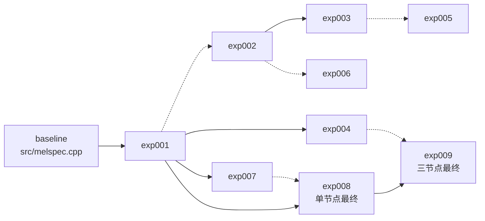

# Melspec 优化汇报讲稿

建议时长：10–13 分钟，另留 3–5 分钟问答。

## 一句话结论

exp001 解决算法浪费，exp008 缩短单节点数据路径，exp009 将同一路径扩展到
三节点。最终单节点方案为 `2.733 s`，三节点方案为 `2.186 s`，两者都通过
官方四个用例。

## 时间分配

| 部分 | 页面 | 建议时间 |
|---|---|---:|
| 开场与九次实验总览 | 1–2 | 1.5 分钟 |
| 代码演进关系 | 3 | 1 分钟 |
| 基线问题与 exp001 | 4–5 | 2.5 分钟 |
| exp008 | 6 | 1.5 分钟 |
| 单节点到多节点与 exp009 | 7 | 2 分钟 |
| GPU 路线与效率分析 | 8 | 2.5 分钟 |
| 结论、参考与 AI | 9 | 1.5 分钟 |
| Q&A | 10 | 3–5 分钟 |

## 第 1 页：封面

这份汇报只保留一条主线：原始实现有哪些问题，exp001 和 exp008 如何逐步
优化，单节点为什么自然扩展到多节点，以及 GPU、CPU+GPU 为什么没有成为
最终方案。

## 第 2 页：exp001–009 结果总览

九次实验全部保留在这张总表里。exp001 是 CPU 算法基础；exp002、exp003、
exp005 和 exp006 是 GPU/异构分支；exp004 是多节点 CPU；exp007 只做
profile；exp008 和 exp009 是两个最终方案。

完整四用例统一相对 exp001 的 64 线程结果 `3.777 s`。最终单节点 exp008 为
`2.733 s`，三节点 exp009 为 `2.186 s`。

## 第 3 页：代码演进关系

蓝线表示直接源码包含或主要演化，灰线表示设计复用。exp007 和 exp008 都
直接包含 exp001，exp009 直接包含 exp008，并复用 exp004 的本地帧划分和
分布写入设计。

## 第 4 页：原始参考实现的问题

原始版本能够正确计算，但热路径有四类明显浪费。第一，每帧重新分配中间
数组、计算位反转，并重复求 twiddle 的 `cos` 和 `sin`。第二，输入是实数，
却执行全长度复数 FFT。第三，Mel 投影遍历所有频率箱并乘零。第四，完整
double 功率谱约 6.3 GB，而且投影访问跨行，缓存局部性差。

同口径 1M 样本 default 上，原实现为 61.663 秒，exp001 为 0.084 秒，加速
731.206 倍。

## 第 5 页：exp001 的算法优化

exp001 做三件最容易解释的事。它将实数输入打包，使核心 FFT 长度从 `n_fft`
降到 `n_fft/2`。它将 Mel 三角滤波器存成稀疏结构，只遍历非零区间。它按
256 帧分块，并把 FFT、功率和 Mel 放进同一条 OpenMP/SIMD 热路径。

64 线程 spread 下，四用例合计为 `3.777 s`。这个版本为后续单节点和多节点
优化提供共同基础。

## 第 6 页：exp008 单节点最终方案

exp008 保留 exp001 的 FFT 和 Mel 数学，只优化数据路径。PCM 归一化改为
并行。每个 tile 不再单独创建 OpenMP 区域，而是使用覆盖全部帧的单个并行
区域。每个线程直接把 double 累加结果转换为 float32，删除完整 double
输出矩阵和 tile staging。

四用例从 `3.777 s` 降到 `2.733 s`，相对 exp001 加速 `1.382x`。同口径
1M 样本相对原实现加速 `1427.391x`，峰值内存约 394 MB。

## 第 7 页：单节点到多节点

单节点优化后，剩余代价主要在完整输出和总帧规模，因此自然想到按连续帧
划分给多个节点。每个 rank 只读取自己需要的 PCM 区间，独立计算后通过
`pwrite` 写出不重叠的帧列，不需要最终 Gather。原生 Slurm 启动避免了 MPI
初始化开销。

两节点旧路径合计 `3.083 s`，三节点旧路径 `2.533 s`，说明增加节点并不
自动变快。最终 exp009 把 exp008 的直接 float32 数据路径和三节点分发结合，
降到 `2.186 s`，相对 exp001 加速 `1.728x`。

## 第 8 页：GPU 与 CPU+GPU 为什么没有胜出

GPU 路线中最好的是两节点纯 GPU exp006，四用例合计 `4.024 s`，仍慢于
CPU 最终方案。GPU 计算本身不慢，但完整进程还要承担 CUDA 初始化、显存分配、
cuFFT plan、H2D、D2H、stream 同步和文件写入。

exp006 的 default profile 中，每个 rank 输入读取约 `0.093 s`，CUDA 初始化
约 `0.06 s`，含传输和同步的 GPU 路径约 `0.16–0.23 s`，共享输出写入约
`0.28–0.49 s`。每 rank 约执行 94 次 1024 帧同步，D2H 还写入 pageable
buffer，下一批计算无法和上一批传输重叠。

因此，输入磁盘 I/O 不是主要瓶颈。端到端损失主要来自设备主机传输、同步
和输出 I/O。CPU+GPU 还需要共享主机内存和 I/O，最终等待较慢的一侧，因此
没有超过纯 GPU。

## 第 9 页：结论、参考资料与 AI

最终保留两个方案。单节点 exp008 为 `2.733 s`，三节点 exp009 为
`2.186 s`，两者均通过官方四个用例。三节点是总体最快方案。

项目内参考题目 README、原始 C++ 与 Python 实现、公开头文件和
`validate.py`。外部参考 NVIDIA CUDA/cuFFT、OpenMP、GCC 和 Slurm 官方
文档。AI 使用 OpenAI Codex（GPT-5）辅助代码阅读、方案讨论、实现草稿、
实验编排和文档整理，所有正式数据均来自实际 Slurm 作业。

## 第 10 页：Q&A

先确认评委问的是性能口径、实现细节还是工程过程。回答时先给结论，再给
一个数字，最后指向源码或日志。

## Q&A 速查

### 1. 为什么基线这么慢？

每帧重复分配和计算 FFT 准备，实数输入仍执行全长度复数 FFT，Mel 投影
包含大量乘零，并物化约 6.3 GB 的完整功率谱。

### 2. exp001 最关键的优化是什么？

打包实数 FFT 和稀疏 Mel 是算法层的核心。前者把 FFT 长度减半，后者删除
大部分无意义乘法。

### 3. exp008 相比 exp001 改了什么？

保留数学实现，只缩短数据路径。并行归一化、单 OpenMP 区域和直接 float32
输出减少了内存占用、重复并行区和最终转换。

### 4. 为什么要从单节点走向多节点？

单节点已经把计算压缩到较低水平，继续扩展帧级并行最直接的办法是按连续帧
区间拆分到多个节点。

### 5. 为什么两节点旧版反而更慢？

两节点 exp004 使用较早的 tile 和输出路径，合计 `3.083 s`，比 exp008 的
`2.733 s` 慢。节点增加带来协调和 I/O 成本，必须同时优化数据路径。

### 6. exp009 为什么是三节点最快？

它同时采用本地 PCM 读取、单 OpenMP 区域、直接 float32 输出和分布式
`pwrite`，避免 Gather 与 MPI 启动开销。

### 7. GPU 没有赢，主要是不是 I/O 瓶颈？

输入磁盘 I/O 不是主因。exp006 每 rank 读取约 `0.093 s`。主要成本是
H2D/D2H、pageable 输出、每 1024 帧一次同步，以及 `0.28–0.49 s` 的输出写。

### 8. 为什么 CPU+GPU 没有超过纯 GPU？

CPU 和 GPU 竞争主机内存与 I/O，帧数拆给两侧后，wall time 仍由较慢的
尾部决定。exp003 调参中 0% CPU 反而最快。

### 9. 为什么 GPU 每 1024 帧就同步？

当前实现以 tile 为单位完成计算和 D2H，然后同步一次。这样简单且正确，但
不能把下一 tile 的 GPU 计算与上一 tile 的传输重叠。

### 10. 最大的加速数字是多少？

同口径 1M default 前缀上，exp008 相对原实现为 `1427.391x`，exp009 为
`156.271x`。完整四用例相对 exp001 T=64，exp008 为 `1.382x`，exp009 为
`1.728x`。

### 11. 为什么 exp009 的 1M 加速低于 exp008？

三节点短输入需要承担更多进程启动和 rank 协调。输入变大后，三节点总耗时
在完整四用例中体现出优势。

### 12. 如何复现最终成果？

默认 `make` 构建 exp008，`make final-three-node` 构建 exp009。三节点正式
验证使用 `scripts/run_exp009_slurm_fast_3node.slurm`。

### 13. 为什么没有直接使用 FFTW 或 oneMKL？

题目允许科学库，但当前方案优先选择可解释、可移植的自实现路径。未来可以在
相同输入上评估 FFTW 或 oneMKL，而不能只凭库的峰值性能替换已验证实现。

### 14. 数值和性能数据是否可靠？

两个最终方案均通过官方 `4/4 PASS`。性能来自 Slurm 三次运行最小值。1M
前缀只用于原实现速度对照，不与完整四用例加速混用。

### 15. AI 在解题中做了什么？

OpenAI Codex（GPT-5）辅助代码阅读、方案讨论、实现草稿、Slurm 实验编排、
日志整理和材料生成。正式性能数据全部来自实际作业，提交者需要能根据源码
和日志解释每项优化。
