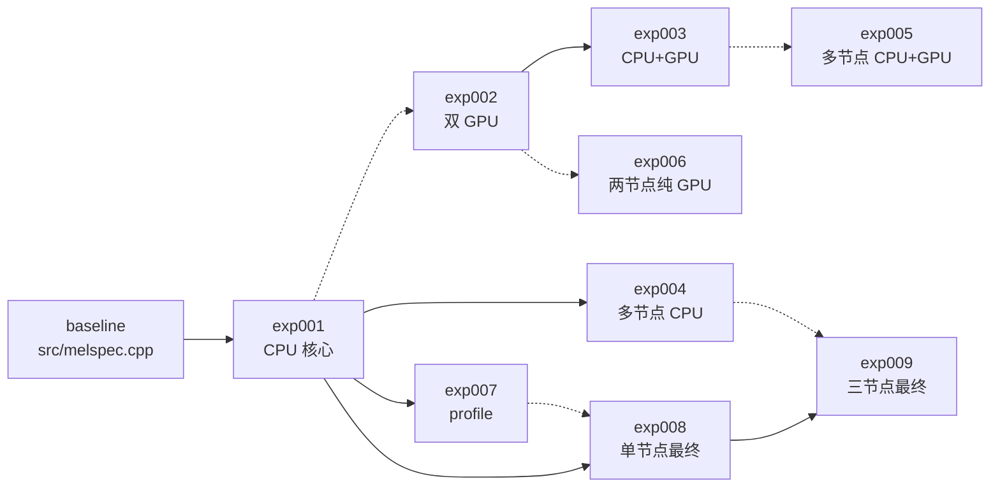

# Melspec 优化汇报讲稿

建议时长：14–18 分钟。

## 一句话结论

exp001 的算法优化建立了 CPU 基础，exp008 和 exp009 进一步压缩数据路径与
多节点开销。三节点 CPU 流水化版本最终以 `2.186 s` 通过全部四个官方用例，
相比 exp001 的 64 线程结果加速 `1.728x`。最终保留的单节点 exp008 和三节点
exp009 在同口径 1M 样本测试上，分别相对原实现加速 `1427.391x` 和 `156.271x`。

## 时间分配

| 部分 | 页面 | 建议时间 |
|---|---|---:|
| 开场与评测口径 | 1–2 | 1 分钟 |
| 总体结果与逐步优化 | 3–4 | 2 分钟 |
| 代码演进关系 | 5 | 1 分钟 |
| 基线问题与 exp001 | 6–7 | 2.5 分钟 |
| GPU 路线 | 8 | 1 分钟 |
| GPU 效率分析 | 9 | 1.5 分钟 |
| profiling 与单节点优化 | 10–11 | 2.5 分钟 |
| 三节点优化与瓶颈 | 12–13 | 2.5 分钟 |
| 参考资料、AI 与 bug | 14–15 | 2 分钟 |
| 结论 | 16 | 1 分钟 |
| Q&A | 17 | 1.5 分钟以上 |

## 第 1 页：封面

**讲法**

这份汇报复盘 2026 秋季招新题中的 melspec 性能优化。内容覆盖单节点 CPU、
单节点 GPU、多节点 CPU 和多节点 GPU 四条路线，最终给出 4 个官方用例的
远程 Slurm 实测结果。

## 第 2 页：评测范围与统一口径

**讲法**

评测有四个固定用例：default、small_mels、large_fft 和 narrow_band。每个
正式结果运行 3 次并取最小值，要求与官方 expected 输出在相同容差内一致。

性能基线统一使用 exp001 的 64 线程 spread 结果，合计 3.777 秒。这里需要
区分两个 exp001 数据：16 线程正式验证为 7.572 秒，64 线程调优为 3.777 秒。
后续比较一律使用后者，避免高估其他实验。

**证据**

- `docs/experiment-report.md`
- `logs/001_packed_fft_sparse_mel_simd_slurm-187.log`
- `logs/cpu-thread-scaling_slurm-275.log`

## 第 3 页：总体性能结果

**讲法**

先看最终结果。exp009 以 2.186 秒排名第一，exp004 和三节点 CPU 为 2.533 秒，
单节点 exp008 为 2.733 秒。GPU 路线中最好的是 exp006，合计 4.024 秒。

这个结果说明，本题的端到端瓶颈不只是算术。GPU 很快，但数据搬运和输出文件
占用了大量固定成本。

## 第 4 页：每一步优化与效果

**讲法**

这一页按顺序列出每个实验的改动与结果。exp001 用打包实数 FFT、稀疏 Mel 和
OpenMP 把四用例降到 3.777 秒。exp002 和 exp003 分别尝试单节点双 GPU 与
CPU+GPU，但没有超过 exp001。exp004 使用三节点原生 Slurm，把合计降到 2.533 秒。
exp005 和 exp006 继续验证多节点 GPU 路线，其中 exp006 最好为 4.024 秒。
exp007 是只做测量的阶段 driver。exp008 优化单节点数据路径到 2.733 秒，
exp009 再移植到三节点，最终为 2.186 秒。

表中“相对 exp001”是四个官方用例的性能口径。另外，在相同 1M 样本前缀上，
单节点最终方案 exp008 相对原实现提升 1427.391 倍，三节点最终方案 exp009
提升 156.271 倍。三节点在短输入上的启动成本更高。

## 第 5 页：代码演进关系

**讲法**

代码关系不是单向直线。基线先演化出 exp001，exp001 是后续 CPU 主线的共同
基础。上侧从 exp001 分出 GPU 路线，依次是 exp002、exp003 和 exp005，
exp006 是独立纯 GPU 对照。中间多节点分支由 exp001 派生 exp004。

最终主线是 exp001 分别派生 exp007 和 exp008，其中 exp007 是 profiling
driver，exp008 再通过直接源码包含派生 exp009。exp009 还复用 exp004 的本地
帧划分和分布写入设计。图中的蓝线表示直接包含或主要演化，灰线表示设计复用。

## 第 6 页：基线实现的主要问题

**讲法**

原始版本能够正确计算，但热路径存在四类明显浪费。第一，每一帧都重新分配
中间数组、重新计算位反转，并在每个 FFT stage 内重复求 twiddle 的
`cos` 和 `sin`。第二，输入是实数，却仍执行全长度复数 FFT，没有利用
共轭对称把核心长度减半。第三，Mel 投影对所有频率箱做稠密乘法，其中大量
权重为零。第四，完整功率谱 `[bin, frame]` 会被物化；default 的 double
功率谱约为 6.3 GB，且投影访问跨行，缓存局部性很差。

在同口径 1M 样本 default 输入上，原实现为 61.663 秒，exp001 为
0.084 秒，速度提升 731.206 倍。这些数字说明原始瓶颈主要来自重复计算、
乘零和内存流量，而不是输入 I/O。

## 第 7 页：exp001 的计算优化

**讲法**

exp001 的关键是减少无用计算和减少内存工作。实数输入通过打包把核心 FFT
长度从 n_fft 降到 n_fft/2。Mel 投影只遍历三角滤波器的非零区间。每 256
帧组成一个 tile，FFT、功率和 Mel 都在同一数据局部区域内完成。

64 线程 spread 下，default 为 0.931 秒，small_mels 为 0.569 秒，合计
3.777 秒。这个版本为后续 GPU 和多节点实验提供了稳定基线。

## 第 8 页：GPU 路线的收益与限制

**讲法**

单节点双 GPU 的 exp002 合计 5.164 秒。GPU 计算本身并不慢，但每次调用都要
经历 CUDA context、显存分配、cuFFT plan、H2D、D2H 和 stream 同步。

CPU+GPU 的 exp003 合计 5.207 秒。CPU 分担 2% 帧时反而比纯 GPU 慢。两个
执行者竞争内存带宽，最终仍要等待较慢的一侧。

多节点纯 GPU 的 exp006 把合计降到 4.024 秒，主要收益来自本地 PCM 读取和
移除 CPU 帧计算，但仍慢于 64 线程 exp001。

## 第 9 页：GPU 效率分析

**讲法**

需要区分 GPU 算术效率和端到端效率。exp006 的 default profile 中，每个 rank
读取输入约 0.093 秒，CUDA 初始化和 plan 约 0.06 秒，包含 H2D、kernel、D2H
和同步的 GPU 路径约 0.16 到 0.23 秒，最终共享文件写入约 0.28 到 0.49 秒。

所以输入磁盘 I/O 不是主要瓶颈，更准确地说，瓶颈是设备主机传输、每 1024
帧一次 stream 同步，以及共享输出写入。default 中每个 rank 约同步 94 次，
下一批计算不能和上一批 D2H 重叠。D2H 还写入 pageable buffer，增加了中间
staging 成本。换句话说，GPU 算力没有成为主要限制，完整数据通路才是。

## 第 10 页：单节点阶段 profiling

**讲法**

为了避免凭感觉优化，exp007 把 default 拆成四段。读取与归一化约 0.20 秒，
FFT 和 Mel 计算约 0.50 秒，double 转 float 与写入约 0.24 秒。峰值内存
约 779 MB。

完整写盘和输出到 `/dev/null` 只差 70 到 90 毫秒，说明磁盘 payload 不是
唯一问题。真正值得先改的是串行归一化、完整 double 输出矩阵和最后一次
float 转换。

## 第 11 页：exp008 单节点最终方案

**讲法**

exp008 保留 exp001 的计算数学，但改了三处数据路径。PCM 归一化使用 64 线程。
每个 tile 不再单独创建 OpenMP 并行区域，而是用一个区域覆盖全部帧。每个
线程直接把 double 累加结果转换为 float32 写入最终 Mel。

default 从约 0.93 秒降到 0.629 秒，四用例合计 2.733 秒，加速 1.382 倍。
峰值内存从 779 MB 降到 394 MB。同口径 1M 样本测试上，exp008 相对原实现
加速 1427.391 倍。

## 第 12 页：exp009 三节点最终方案

**讲法**

exp009 使用三个 Slurm rank，每个节点一个 rank 和 64 个 CPU 线程。每个 rank
只读取自己连续帧所需的 PCM 区间。计算仍然使用单 OpenMP 区域直接输出
float32。rank 之间用 64-bit token 协调，随后分别写入输出矩阵的不重叠列。

四用例为 0.599、0.275、0.661 和 0.651 秒，合计 2.186 秒。相比三节点
exp004 再快 1.159 倍，相比 exp001 快 1.728 倍。同口径 1M 样本测试上，
exp009 相对原实现加速 156.271 倍。

## 第 13 页：当前瓶颈

**讲法**

exp009 的 default profile 很清楚。每 rank 本地读取约 0.02 秒，归一化约
0.04 秒，计算约 0.13 秒，分布式写入约 0.28 秒。输出已经占总 wall 时间
的一半左右。

因此，继续增加 CPU 核数或 GPU 数量的收益有限。下一轮应该做输出流水，
尝试异步写入、不同文件布局或 mmap，但必须先单独验证共享文件系统的行为。

## 第 14 页：参考资料与 AI 工具

**讲法**

项目内主要参考题目 README、原始 C++ 与 Python 实现、公开头文件和
`validate.py`。外部主要依据 CUDA Runtime、cuFFT、OpenMP、GCC 和 Slurm
的官方 API 文档。

AI 工具使用 OpenAI Codex（GPT-5），用于代码阅读、方案讨论、实现草稿、
远程实验编排、日志整理和文档/PPT 制作。所有正式性能数字都来自实际 Slurm
作业，没有用生成数据代替实测。最终代码通过编译、官方用例和日志复核。

**证据**

- `docs/references-and-ai.md`
- `docs/experiment-report.md`

## 第 15 页：典型 bug

**讲法**

这里有四个值得记录的问题。第一，benchmark 把 1M 临时输入放在某个节点的
`/tmp`，另外两个节点看不到，导致 rank 以 143 退出。改成共享目录后通过。

第二，固定输出路径和 ready 文件存在竞态。最终协议使用每轮 64-bit token，
只有确认当前轮 token 的 rank 才写输出。

第三，NVCC 把 `-Wl,-rpath` 当作未知选项。最终改为通过 `LD_LIBRARY_PATH`
查找 CUDA 库。

第四，集群 `perf_event_paranoid=4` 禁止硬件计数器。于是改用 exp007 的阶段
计时，明确区分有效数据与权限失败。

## 第 16 页：结论与后续方向

**讲法**

这段工作的主要结论有三点。第一，exp001 的算法基础把本题从朴素实现推进到
可控的 3.777 秒。第二，GPU 在当前完整 I/O 路径下没有超过高度优化的 CPU。
第三，单节点和多节点拆分后，exp008 与 exp009 分别把单节点和多节点推进到
2.733 秒和 2.186 秒。与原始实现做同口径 1M 样本对照，exp008 和 exp009
的端到端速度分别提升 1427.391 倍和 156.271 倍。

按照当前决定，优化工作在这里停止。后续如果继续，优先顺序是输出写入、
FFT/Mel 内部 profiling，以及更完整的跨应用验证。

## 第 17 页：Q&A

**讲法**

进入 Q&A 后先确认评委问的是性能口径、实现细节还是工程过程。回答时先给
结论，再给一个数字，最后指出对应日志或源码。下面是高频问题的准备稿。

## 常见问答

### 为什么 GPU 没有赢？

GPU 的计算阶段很快，但 benchmark 是短进程端到端计时。CUDA 初始化、数据
搬运、每 1024 帧同步和共享文件输出占了大部分固定成本。

### GPU 效率低，主要是 I/O 瓶颈吗？

不是输入磁盘 I/O。exp006 的每 rank PCM 读取只有约 0.093 秒。主要成本是
设备主机传输、pageable D2H、每 1024 帧一次 stream 同步，以及 0.28 到
0.49 秒的共享输出写入。因此它是端到端数据搬运和输出 I/O 瓶颈，不是 GPU
算术吞吐不足，也不是输入文件读取不足。

### 为什么 CPU+GPU 反而更慢？

CPU 和 GPU 共享主机内存与 I/O 资源。加入 CPU 分担后，GPU 处理帧数减少，
但两端竞争增加，最终 wall 时间取决于较慢的一侧。exp003 的调参已经显示
0% CPU 比 2% 到 12% 更快。

### 最不可替代的优化是什么？

exp001 的半长度实数 FFT 和稀疏 Mel 是算法基础。exp008 和 exp009 的主要
贡献是去除数据路径中的额外矩阵、重复并行区和串行转换。

### 是否还有继续加速空间？

有，但主要不在 FFT 计算。exp009 当前约 0.28 秒花在分布式写入，下一轮应
优先优化输出 I/O。

### 数值是否可靠？

所有正式结果均通过 `4/4 PASS`。最大绝对误差与 exp001 一致，分别是
3.12e-2、1.17e-2、1.25e-1 和 6.25e-2。

### 为什么同时出现 1.728x、731.206x 和 1427.391x？

`1.728x` 是两个最终方案在完整官方四用例上相对 exp001 T=64 的聚合加速。
`731.206x` 和 `1427.391x` 是 1M 样本 default 前缀上相对原实现的加速。
三者输入范围不同，不能互换。答辩时先说明分母和输入范围，再给数字。

### 为什么单节点 1M 前缀有 1427.391x，但官方四例只比 exp001 快 1.382x？

1M 前缀主要放大了原实现的重复 FFT 准备、乘零和糟糕缓存访问，因此相对
原实现的数字特别高。exp001 和 exp008 都已经是优化实现，完整四用例比较时
两者的绝对差距只来自数据路径改进，所以 exp008 相对 exp001 是 1.382x。

### 为什么基线用 64 线程而不是 16 线程？

job 275 在 64 核节点上比较了 1 到 64 线程和 close/spread 两种绑定。
64 线程 spread 的四用例合计为 3.777 秒，16 线程为 7.415 秒。选择 64 线程
可以给所有后续方案提供更强的同机基线，也能避免夸大优化效果。

### 三节点一定优于两节点吗？

在本次 workload 中，三节点 exp009 为 2.186 秒，两节点 exp004 为
2.533 秒，三节点更快。但三节点也增加了 rank 协调和共享文件写入成本。
如果输入更短，单节点启动开销可能更有优势。

### 为什么不直接使用 FFTW、oneMKL 或更多 GPU？

题目允许科学计算库，但当前提交选择可解释、可移植的自实现路径。现有结果
已经把主要算法和 I/O 结构跑通。下一轮可以单独评估 FFTW、oneMKL 或 cuFFT
与当前实现做同输入对照，不能仅凭理论吞吐替换已验证结果。

### 如何复现最终成果？

单节点执行 `make clean && make -j64`，默认得到 exp008 并生成 `./melspec`。
三节点执行 `make final-three-node`，再提交
`scripts/run_exp009_slurm_fast_3node.slurm`。原始对照使用
`scripts/run_final_baseline_speedup.slurm`。

### 输出文件这么大，为什么单节点仍然比 GPU 快？

GPU 计算阶段只要约 0.16 到 0.23 秒，但这只是端到端流程的一段。CUDA
初始化、H2D、D2H、stream 同步和最终写入都要计入 wall time。CPU 路径直接
在主机内存中计算并写出，少了设备往返，因此在本 workload 上更划算。

### 共享输出如何避免竞争？

launcher 预创建共享输出和 ready 文件。rank 0 为每轮写入 64-bit token，
其他 rank 通过 `pread` 确认当前轮 token 后再 `pwrite` 各自的连续帧列。
这同时解决旧 ready 状态和重复运行竞态。

### AI 在其中做了什么，哪些部分需要你负责解释？

OpenAI Codex（GPT-5）参与了代码阅读、方案讨论、实现草稿、Slurm 编排和
文档整理。提交者负责理解 FFT 打包、稀疏 Mel、OpenMP 并行边界、CUDA 数据
搬运和多节点一致性，并能依据源码和日志解释每一处结论。AI 没有生成性能
数据，所有正式数字都来自实际作业。
